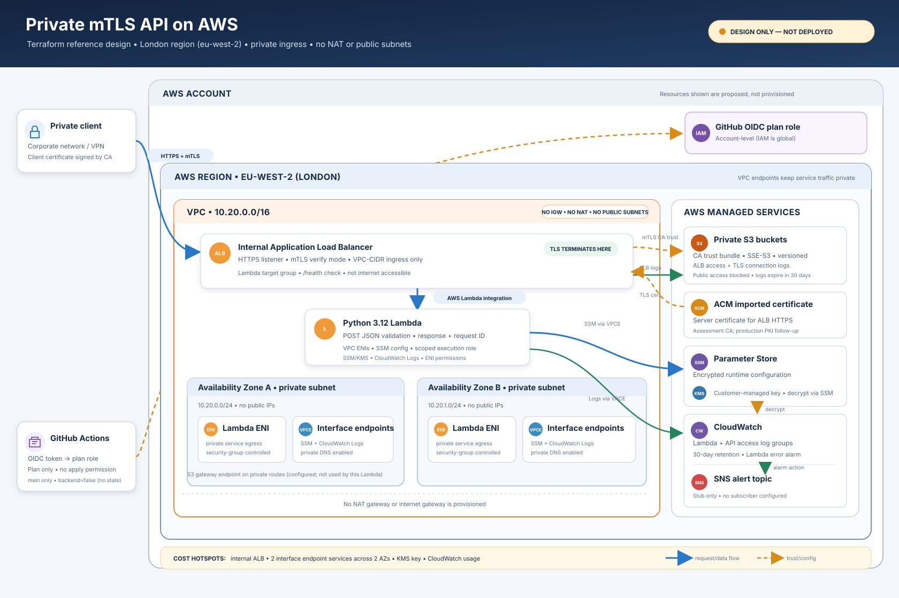

# CPE Task 2026 — Private AWS API

This repository provides a Terraform reference implementation for an internal
AWS API. A private client connects through an internal Application Load Balancer
(ALB), authenticates with mutual TLS (mTLS), and calls a Python Lambda function
through private AWS networking.

**Current status:** The implementation has passed local Terraform formatting,
Terraform validation, and Lambda unit tests. It has **not been deployed to
AWS**. The live OIDC provider, AWS IAM role, remote state backend, branch
ruleset, and AWS resources must be created separately.

## Contents

1. [Architecture](#architecture)
2. [Implementation status](#implementation-status)
3. [Repository structure](#repository-structure)
4. [Prerequisites](#prerequisites)
5. [Local validation](#local-validation)
6. [Configuration](#configuration)
7. [Deployment](#deployment)
8. [Remote state](#remote-state)
9. [Post-deployment testing](#post-deployment-testing)
10. [GitHub Actions and merge gates](#github-actions-and-merge-gates)
11. [GitHub OIDC plan role](#github-oidc-plan-role)
12. [Security and observability](#security-and-observability)
13. [Assumptions](#assumptions)
14. [Gaps and production follow-up](#gaps-and-production-follow-up)
15. [Design decisions and alternatives](#design-decisions-and-alternatives)
16. [AI usage and critique](#ai-usage-and-critique)
17. [Teardown](#teardown)
18. [Documentation and presentations](#documentation-and-presentations)

## Architecture



The request path is:

```text
Internal client
  -> private network
  -> internal ALB HTTPS/mTLS listener
  -> ALB Lambda target group
  -> VPC-attached Lambda
  -> SSM or CloudWatch Logs through private VPC endpoints
```

Key components:

- A VPC with two private subnets across two Availability Zones.
- An internal ALB with HTTPS and mTLS verification.
- A Python 3.12 Lambda that implements `GET /health` and `POST /`.
- SSM Parameter Store for the runtime message-length setting.
- A customer-managed KMS key for the SSM SecureString.
- SSM and CloudWatch Logs interface endpoints.
- An S3 gateway endpoint.
- Private S3 buckets for the CA trust bundle and ALB access/connection logs.
- CloudWatch log groups, a Lambda error alarm, and an SNS topic stub.
- Terraform provider and CI policies for repeatable delivery.

There are no internet gateway or NAT gateway routes in this configuration.
The ALB is not internet-facing and has no public IP.

## Implementation status

| Area | Status |
|---|---|
| VPC and two private subnets | Implemented in Terraform |
| Security groups and private route tables | Implemented in Terraform |
| SSM and CloudWatch Logs interface endpoints | Implemented in Terraform |
| S3 gateway endpoint | Implemented in Terraform |
| Internal ALB and Lambda target | Implemented in Terraform |
| ALB mTLS trust store | Implemented in Terraform |
| Assessment CA, server, and client certificates | Implemented with the Terraform TLS provider |
| Runtime configuration in SSM/KMS | Implemented in Terraform |
| Lambda application and unit tests | Implemented |
| CloudWatch logs and Lambda error alarm | Implemented in Terraform |
| ALB access and TLS connection logs | Implemented in Terraform |
| GitHub validation, tests, and Checkov | Implemented |
| GitHub OIDC plan job | Workflow implemented; AWS provider/role not created |
| Remote state and locking | Documented, but not implemented |
| AWS deployment | Not performed |
| Central multi-account logging | Documented, but not implemented |
| AWS Private CA or enterprise PKI | Documented, but not implemented |
| Production private DNS/certificate | Documented, but not implemented |

## Repository structure

| Path | Purpose |
|---|---|
| `network.tf` | VPC, private subnets, route tables, security groups, and VPC endpoints |
| `api.tf` | Internal ALB, HTTPS listener, mTLS trust store, target group, and Lambda attachment |
| `lambda.tf` | Lambda deployment and CloudWatch log groups |
| `lambda/index.py` | API implementation |
| `iam.tf` | Lambda execution role and ALB invocation permission |
| `certificates.tf` | Assessment CA and server/client certificates |
| `storage.tf` | KMS, SSM, CA trust bundle, and ALB log buckets |
| `observability.tf` | Lambda error alarm and SNS topic |
| `variables.tf` | Deployment variables and validation |
| `locals.tf` | Shared names and calculated subnet CIDRs |
| `outputs.tf` | ALB DNS name and test certificate outputs |
| `tests/test_lambda.py` | Local Lambda unit tests |
| `.github/workflows/terraform.yml` | Validation, Checkov, and post-merge plan workflow |
| `.github/rulesets/main-branch.json` | Proposed main-branch ruleset |
| `docs/` | Architecture diagram, HLD/LLD, and cost presentation |

## Prerequisites

- Terraform 1.6 or later.
- AWS credentials with permission to create the resources locally.
- An AWS account and region with at least two available Availability Zones.
- Private network connectivity from an internal client to the VPC.
- Python 3.12 for the workflow and local tests.
- An S3 state bucket and locking configuration if remote state is used.

Do not commit:

- AWS credentials or access keys.
- Private CA, server, or client keys.
- Terraform state files.
- Local certificate files or `terraform.tfvars`.

The default AWS region is `eu-west-2`.

## Local validation

Run formatting, Terraform validation, and Lambda tests before planning:

```sh
terraform fmt -check -recursive
terraform init -backend=false
terraform validate
python3 -m unittest discover -s tests -v
```

Run formatting before the final validation:

```sh
terraform fmt -recursive
```

Use the repository versions:

- Terraform: 1.9.8 in GitHub Actions
- AWS provider: selected by `.terraform.lock.hcl`
- Checkov: pinned in `requirements-dev.txt`

## Configuration

Defaults are in `variables.tf`. Override them in a local
`terraform.tfvars` file:

```hcl
aws_region           = "eu-west-2"
environment          = "dev"
vpc_cidr             = "10.20.0.0/16"
allowed_client_cidrs = ["10.20.0.0/16"]
```

Configuration assumptions:

- The VPC CIDR must not overlap an existing connected network.
- `allowed_client_cidrs` should contain the actual approved internal caller
  ranges, not broad public or internet ranges.
- The default source range is the VPC CIDR.
- The two private subnet CIDRs are calculated from the VPC CIDR.
- The environment name is used in resource names and tags.

## Deployment

Review the plan before creating billable resources:

```sh
terraform init
terraform fmt -check -recursive
terraform validate
terraform plan -out=tfplan
terraform apply tfplan
```

Deployment creates billable resources including an internal ALB, interface
VPC endpoints, a customer-managed KMS key, S3 storage, and log groups.
The GitHub workflow does not run `terraform apply`.

### OIDC repository variable

The post-merge plan job requires:

```text
Repository Settings -> Secrets and variables -> Actions -> Variables
Name: AWS_PLAN_ROLE_ARN
Value: ARN of the read-only AWS plan role
```

The AWS OIDC provider and role are separate account resources. They are not
provisioned by this Terraform configuration.

## Remote state

Terraform state contains generated private keys and must be treated as
sensitive.

For a persistent deployment:

1. Bootstrap a private S3 state bucket in a controlled tooling/state account.
2. Enable S3 versioning, public-access blocking, TLS-only policy, and encryption.
3. Create a dedicated KMS key for state.
4. Create a DynamoDB lock table if using Terraform locking.
5. Use separate state keys for account, region, and environment:

```text
cpe/<account-id>/<region>/<environment>/terraform.tfstate
```

6. Configure and initialize the S3 backend:

```sh
terraform init \
  -backend-config="bucket=<state-bucket>" \
  -backend-config="key=cpe/<account-id>/eu-west-2/dev/terraform.tfstate" \
  -backend-config="region=eu-west-2" \
  -backend-config="encrypt=true" \
  -backend-config="kms_key_id=<kms-key-arn>" \
  -backend-config="dynamodb_table=<lock-table>"
```

Do not commit state bucket names, credentials, state files, or private keys.
The backend must exist before `terraform init`.

This project does not configure a remote backend. The CI workflow intentionally
uses `terraform init -backend=false`, so its plan is not drift-aware.

## Post-deployment testing

Run local Lambda tests before deployment:

```sh
python3 -m unittest discover -s tests -v
```

After `terraform apply`, retrieve the test certificate and private key:

```sh
terraform output -raw client_certificate_pem > client.crt
terraform output -raw client_private_key_pem > client.key
chmod 600 client.key
```

Retrieve the ALB DNS name and test the API:

```sh
API_DNS="$(terraform output -raw api_dns_name)"

curl -k --cert client.crt --key client.key \
  -H 'content-type: application/json' \
  -d '{"message":"hello"}' \
  "https://${API_DNS}/"

curl -k --cert client.crt --key client.key \
  "https://${API_DNS}/health"
```

The test uses `-k` because the assessment server certificate does not match
the generated ALB DNS name. Never disable server-certificate verification in
production.

The test should cover:

- Valid POST: HTTP 200.
- Malformed JSON: HTTP 400.
- Missing or non-string `message`: HTTP 400.
- Message beyond the configured maximum: HTTP 400.
- Unsupported method: HTTP 405.
- Request without an approved client certificate: TLS rejection.

Inspect:

- ALB access and TLS connection log objects in S3.
- Lambda and API-access CloudWatch log groups.
- Structured records containing the request ID.
- The Lambda error alarm and SNS topic.
- The ALB scheme and target health.
- Confirmation that no public subnets, internet gateway, or NAT gateway exist.

Remove temporary certificate files after testing:

```sh
rm -f client.crt client.key
```

## GitHub Actions and merge gates

The workflow at `.github/workflows/terraform.yml` performs:

- `terraform fmt -check -recursive`
- `terraform init -backend=false`
- `terraform validate`
- Python Lambda unit tests
- Checkov Terraform security scanning
- A post-merge plan on pushes to `main`
- An optional manual plan on `main`

Checkov policy:

| Severity | Merge behavior |
|---|---|
| Medium, high, critical | Block the security job |
| Low, informational | Report without blocking |

Configure a GitHub ruleset or branch protection rule for `main` that requires:

- A pull request before merging.
- Status check `Format and validate`.
- Status check `Terraform security scan`.

The workflow is on pull requests and pushes to `main`. The plan job does not run
on pull requests and is not a merge gate. It also does not deploy or destroy
resources.

The ruleset JSON in `.github/rulesets/main-branch.json` is a proposed
configuration. The live ruleset must be imported or configured and verified in
GitHub repository settings.

## GitHub OIDC plan role

The AWS plan role is documented and prepared in CI, but it is not provisioned
by this Terraform project.

### Create the OIDC provider

In the target AWS account:

- IAM → Identity providers → Add provider
- Provider type: OpenID Connect
- Provider URL: `https://token.actions.githubusercontent.com`
- Audience: `sts.amazonaws.com`

### Trust policy

Create an IAM role named, for example, `TerraformPlanRole`, with this trust
policy:

```json
{
  "Version": "2012-10-17",
  "Statement": [
    {
      "Effect": "Allow",
      "Principal": {
        "Federated": "arn:aws:iam::<ACCOUNT_ID>:oidc-provider/token.actions.githubusercontent.com"
      },
      "Action": "sts:AssumeRoleWithWebIdentity",
      "Condition": {
        "StringEquals": {
          "token.actions.githubusercontent.com:aud": "sts.amazonaws.com",
          "token.actions.githubusercontent.com:sub":
            "repo:svn-deepak4/CPE-Task-2026:ref:refs/heads/main"
        }
      }
    }
  ]
}
```

The `sub` condition is deliberately scoped to this repository and `main`.
Feature branches, pull requests, tags, forks, and other repositories cannot
assume this role. Manual runs on `main` use the same branch subject.

A separate role would be required for pull-request plans. Its trust subject
would be:

```text
repo:svn-deepak4/CPE-Task-2026:pull_request
```

### Plan-role permissions

The role is read/plan-only. It must not:

- Use `AdministratorAccess`.
- Create, update, or delete resources.
- Attach policies or pass IAM roles.
- Reuse the Lambda execution role.

Grant read/list/get actions for the AWS resources discovered by the plan.
Scope actions to `eu-west-2` and the target account. Replace broad service
wildcards with exact resource ARNs or prefixes where AWS supports it.

If remote state is used, add only:

- `s3:ListBucket` for the exact state bucket.
- `s3:GetObject` for the exact state key.
- DynamoDB lock item actions for the exact lock-table ARN.
- KMS decrypt/generate-data-key actions for the exact state key.

Do not store the role ARN or AWS credentials in the repository. Store the ARN
as the GitHub repository variable `AWS_PLAN_ROLE_ARN`.

## Security and observability

### Network security

- The ALB accepts TCP 443 only from configured internal CIDRs.
- The Lambda has no inbound security-group rule.
- Lambda HTTPS egress is limited to TCP 443 within the VPC CIDR.
- The endpoint security group accepts HTTPS only from the Lambda security group.
- Private subnets have no public IP assignment.
- Custom NACL rules are not required for the assessment.

The Lambda egress rule is broader than ideal and should be tightened to the
actual endpoint destination in production.

### IAM security

- The Lambda role can read only the exact runtime SSM parameter.
- KMS decrypt is restricted to SSM and the exact parameter encryption context.
- Log permissions are restricted to the Lambda and API-access log groups.
- Lambda VPC attachment requires EC2 network-interface permissions with
  `Resource = "*"`.
- An explicit `lambda:SourceFunctionArn` deny prevents function code from using
  the network-management actions.
- The ALB permission is restricted to the Lambda target-group ARN.

### Certificate security

- The Assessment CA, server, and client private keys are generated by Terraform.
- The server private key is imported into ACM for ALB TLS termination.
- The public CA certificate is uploaded to a private S3 bucket.
- The ALB trust store validates client certificates against that public CA
  certificate.
- Terraform state contains every private and public certificate value.
- The sensitive output hides the client private key from normal CLI output, but
  does not remove it from state.

Production should use AWS Private CA or an enterprise PKI, private DNS with a
matching SAN, certificate rotation, and encrypted/restricted remote state.

### Logging and audit

- Lambda and API access records use structured JSON.
- Request bodies are not logged.
- Lambda and API access log groups retain logs for 30 days.
- ALB access logs record HTTP requests.
- ALB connection logs record TLS and client-certificate verification outcomes.
- ALB logs are delivered to private S3 with 30-day lifecycle expiration.
- Security-group rejections that stop traffic before the ALB are not visible in
  ALB or Lambda logs.
- ALB logs are not currently centralized or immutable.
- The Lambda error alarm sends to an SNS topic with no subscriber.

## Assumptions

- The assessment is a cost-conscious design exercise, not a live production
  deployment.
- Internal clients already have private connectivity to the VPC.
- The VPC and connected networks do not have overlapping CIDRs.
- The API does not require public internet access.
- No NAT gateway or internet gateway is required.
- Lambda only needs SSM and CloudWatch Logs private access.
- An internal ALB is acceptable as the private API layer.
- Two AZs provide sufficient assessment availability.
- The VPC, ALB, and Lambda do not require public IP addresses.
- The S3 gateway endpoint is included for the PDF requirement, even though the
  Lambda currently does not call S3.
- Custom NACL rules are not needed for the demo.
- The API accepts a JSON object with a string `message`.
- The maximum message size is `10000` characters.
- `GET /health` is sufficient as a liveness check.
- The sample certificates and local CA are sufficient for testing.
- Normal server-name verification is not demonstrated because the test
  certificate does not match the ALB DNS name.
- The remaining certificate lifecycle is for a production follow-up.
- Remote state is not needed for local assessment validation.
- OIDC is the preferred CI identity, while AWS-side provider/role setup is
  external.
- Pull requests receive no AWS credentials.
- The plan is a syntax/configuration check without deployed state.
- `apply` and `destroy` are separate operator actions.
- Stretch goals are out of scope.

## Gaps and production follow-up

| Gap | Implemented trade-off | Production follow-up |
|---|---|---|
| Private client connectivity | Uses the VPC CIDR assumption; no VPN, peering, or Transit Gateway is created | Establish an approved private route and client CIDR allowlist |
| Server hostname | Testing uses `curl -k` with a certificate that does not match ALB DNS | Use private DNS and a certificate with a matching SAN |
| Certificate lifecycle | Terraform generates a self-signed Assessment CA | Use AWS Private CA or enterprise PKI with issuance, rotation, and revocation |
| Terraform private keys | Keys remain in Terraform state | Use managed PKI and encrypted, access-restricted remote state |
| ALB audit coverage | Access and TLS connection logs are delivered to S3 | Centralize logs and use longer retention or S3 Object Lock where required |
| Pre-ALB network rejects | These do not reach ALB or Lambda | Add VPC Flow Logs and centralize them if required |
| Central logging | CloudWatch and S3 logs remain in the workload account | Use cross-account subscription filters, Firehose/Kinesis, or central S3 |
| Lambda egress | TCP 443 allows all destinations in the VPC CIDR | Restrict to endpoint and service destinations |
| Runtime encryption | KMS protects SSM only | Apply the estate encryption standard to CloudWatch and S3 where required |
| Remote state | No backend or lock table is configured | Bootstrap encrypted S3 state and locking, separate by account/environment |
| CI identity | OIDC provider and plan role are only documented | Provision the provider/role and verify repository/branch trust |
| Merge controls | Workflow and proposed ruleset JSON exist | Verify the live GitHub ruleset and required status checks |
| Deployment | The workflow plans but does not apply or destroy | Add an explicitly approved deployment role/workflow |
| AWS monitoring | SNS topic has no subscriber | Add subscriptions, runbooks, and actionable alarm ownership |
| KMS coverage | Customer-managed key protects SSM | Decide and implement estate-standard encryption for logs and state |

Central logging should use two paths:

- CloudWatch Logs subscription filters to a cross-account central logging
  destination, Firehose/Kinesis, central S3, and an SIEM.
- ALB access and connection logs in a same-region central S3 bucket, with
  cross-account ELB log-delivery permissions.

## Design decisions and alternatives

| Decision | Rationale | Alternative rejected |
|---|---|---|
| Internal ALB | Keeps the entry point private and natively supports ALB mTLS verification and Lambda targets | Private API Gateway was rejected because private API Gateway and native mTLS/custom-domain behavior do not provide this exact combination cleanly |
| Lambda | Matches the requested simple, stateless, event-driven API with minimal compute operations | ECS Fargate was rejected as unnecessary complexity for this assessment; it may suit sustained or container-specific workloads |
| No internet gateway or NAT gateway | The API has no internet business requirement and private endpoints cover required AWS-service traffic | NAT was rejected because it would add cost and an internet egress path without a stated need |
| Two private subnets | Meets the two-AZ requirement and places the ALB/Lambda in separate AZs | Public subnets were rejected because they would introduce public routing and IP exposure |
| SSM Parameter Store | The runtime setting is non-secret and can be decrypted with a scoped IAM/KMS policy | Baking the setting into the Lambda package was rejected; Secrets Manager was not required for a non-secret setting |
| Terraform TLS provider | Self-signed certificates meet the assessment and avoid purchasing a domain or commercial PKI | AWS Private CA was rejected as a live implementation for cost and external-dependency reasons; it remains the production recommendation |
| Security groups | Resource-level, stateful controls are the clearest least-privilege boundary | Custom NACLs were rejected as unnecessary duplication for this assessment |
| CloudWatch and ALB S3 logging | Covers Lambda/application records plus HTTP/TLS delivery coverage | It is not a production central archive until cross-account forwarding and retention controls are added |
| OIDC plan job | Avoids long-lived AWS credentials | The AWS provider/role and deployment approval flow are separate account concerns and are not provisioned here |

Assumption-based explanation:

- The ALB is chosen because mTLS is its native listener capability.
- Lambda is chosen because this API is stateless and short-running.
- ECS or EKS is not expected to improve this assessment's simple workload.
- The implementation optimizes for private networking, security clarity, and
  a short-lived cost-conscious test.

## AI usage and critique

AI assistance was used for:

- Reviewing Terraform structure and resource choices.
- Reviewing IAM least privilege and identifying the AWS-required Lambda
  VPC network-interface wildcard.
- Reviewing the GitHub Actions and Checkov merge-gate approach.
- Reviewing architecture, gap, cost, and presentation documentation.

Output was reviewed against the source files and AWS/Terraform behavior. It was
corrected in the following areas:

- The Lambda VPC execution role retains the required EC2 ENI `Resource = "*"`
  allowance but uses an explicit `lambda:SourceFunctionArn` deny to prevent
  function code from using network-management actions.
- Lambda-only access logs were not presented as complete audit coverage.
  ALB access and connection logs were added for HTTP/TLS visibility.
- The initial OIDC/branch documentation did not claim that AWS IAM resources
  had been created. The README now labels the provider/role as external setup.
- The workflow plan does not run on pull requests and uses no deployed state.
  It is documented as post-merge and non-state-aware.
- The design does not claim that private API Gateway provides native private
  API mTLS. It records the API Gateway trade-off and uses an internal ALB.
- The test certificate hostname mismatch is documented. Production server-name
  verification is not disabled in the implementation guidance.

## Teardown

Destroy the stack only after testing:

```sh
terraform destroy
```

Before destruction:

- Download or preserve audit evidence required by the assessment.
- Preserve or manually empty the ALB log bucket; it is not force-destroyed.
- Remove local `client.crt` and `client.key`.

The KMS key is scheduled for deletion with a 7-day waiting period and may
remain visible as pending deletion.

Clean up separately created resources:

- Remote-state S3 bucket.
- DynamoDB lock table.
- GitHub OIDC provider.
- GitHub plan IAM role.
- GitHub ruleset and repository variables.
- Retained CloudWatch log groups or subscriptions.

After teardown:

- Confirm that the ALB and interface endpoints are gone.
- Remove local certificate files.
- Review billing and AWS CloudTrail/resource inventories.

```sh
rm -f client.crt client.key
```

## Documentation and presentations

- Architecture diagram: [SVG](./docs/aws-architecture.svg)
- Architecture image: [PNG](./docs/aws-architecture.png)
- High-level and low-level design:
  [Application and Infrastructure Design](./docs/application-infrastructure-design.md)
- AWS cost presentation:
  [AWS API Deployment Cost](./docs/aws-api-cost-presentation.pptx)
- Presentation source brief:
  [Cloud Platform Engineering — 2026 Technical Assessment (AWS)](<./Cloud Platform Engineering - 2026 Technical Assessment (AWS).pdf>)
