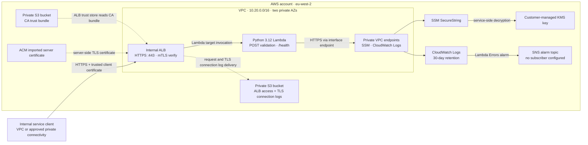

# Internal mTLS API — High-Level and Low-Level Design

| Document status | Design based on the Terraform implementation; **not deployed to AWS** |
|---|---|
| Audience | Product engineering, cloud platform, security, and interview reviewers |
| Region | `eu-west-2` (London) |
| Scope | Assessment core requirements; stretch goals are excluded |

Source brief: [Cloud Platform Engineering — 2026 Technical Assessment (AWS)](<../Cloud Platform Engineering - 2026 Technical Assessment (AWS).pdf>)

## 1. Executive summary

This design provides a private HTTP API for services that can reach the VPC.
An internal Application Load Balancer (ALB) terminates HTTPS and verifies
client certificates using mutual TLS (mTLS), then invokes a Python Lambda
function. The function validates a JSON message, reads its size limit from an
encrypted Systems Manager (SSM) Parameter Store parameter, and returns a JSON
response. There are no public subnets, internet gateway, or NAT gateway.

Terraform defines the network, ALB, Lambda, certificates, runtime configuration,
logging, alarm, and supporting IAM. GitHub Actions validates changes and runs a
Terraform security scan on pull requests; its AWS plan job is post-merge and
uses OIDC.

The design is intentionally costed rather than deployed. The generated private
keys are present in Terraform state, and the sample certificate and logging
choices need production hardening. Those limitations and next steps are called
out below rather than presented as completed controls.

## 2. Goals and boundaries

### Goals

- Accept traffic only through a private endpoint reachable from allowed
  internal client networks.
- Require a client certificate signed by the configured CA before forwarding
  a request to the application.
- Validate API input, return useful HTTP status codes, and include a request ID
  in responses and structured logs.
- Keep workload-to-AWS-service traffic private, and use Terraform for
  repeatable infrastructure.
- Describe the operational, cost, and production gaps explicitly.

### Out of scope

- Public internet access, NAT, a purchased domain, or a commercial certificate.
- Production PKI issuance and rotation, multi-account log forwarding, or
  remote Terraform state provisioning.
- API-specific authorization beyond validating the client certificate at the
  ALB. mTLS authenticates possession of a trusted certificate; it does not by
  itself define which API operations each client may use.
- Optional assessment stretch goals.

## 3. High-level design

The existing presentation diagram is available as
[SVG](./aws-architecture.svg) and [PNG](./aws-architecture.png). The following
view focuses on the application request path and trust boundaries.



### Component responsibilities

| Component | Responsibility |
|---|---|
| Internal client | Connects over private routing and presents a client certificate and its private key during TLS negotiation. |
| Internal ALB | Provides a private DNS endpoint, terminates HTTPS, verifies client certificates against its S3-backed trust store, and forwards accepted requests to Lambda. |
| Lambda | Implements `/health` and `POST /`, validates input, retrieves runtime configuration, and emits structured application/access records. |
| SSM Parameter Store and KMS | Store the message length setting as a `SecureString`; KMS decrypt is constrained to SSM and the exact parameter encryption context. |
| S3 | Stores the CA public certificate bundle needed by the ALB trust store. The bucket is private, versioned, and configured for server-side encryption. |
| ALB log bucket | Receives request-level access logs and TLS connection logs, including client certificate verification outcomes. It is private, uses SSE-S3 as required for ALB log delivery, and expires objects after 30 days. |
| CloudWatch and SNS | Retain Lambda and application access logs and notify the configured SNS topic when the Lambda error alarm breaches. The topic currently has no subscriber. |
| GitHub Actions | Runs formatting, validation, unit tests, and Checkov. A post-merge Terraform plan authenticates through OIDC; no long-lived AWS keys are used. |

### Trust boundaries

1. **Client to VPC:** only private network paths and configured source CIDRs
   are admitted. An internal ALB does not provide a public endpoint.
2. **TLS client authentication:** the ALB validates the presented client
   certificate against the CA trust bundle. Invalid certificates are rejected
   before the Lambda handler runs.
3. **ALB to Lambda:** the ALB invokes the Lambda target using a permission
   scoped to the target group ARN.
4. **Lambda to AWS services:** Lambda uses its execution role and private
   service endpoints for runtime configuration and its explicit API access-log
   write. The function has no general internet route.
5. **Build system to AWS:** GitHub Actions obtains short-lived credentials
   through OIDC for the plan job. The OIDC provider and IAM role must be
   provisioned separately and restricted to this repository and `main`.
6. **Terraform state:** generated CA, client, and server private keys are
   sensitive state contents. State access is therefore a security boundary,
   not merely a deployment detail.

### Key design choices

| Choice | Reason and trade-off |
|---|---|
| Internal ALB with mTLS | Chosen because an ALB supports mTLS verification and a Lambda target while remaining private. It has a recurring hourly/usage cost. |
| Not API Gateway private REST API | A private REST API can be restricted with an `execute-api` VPC endpoint and resource policy, but API Gateway native mTLS is not supported for private APIs. Regional API Gateway custom-domain mTLS has different endpoint characteristics and does not provide this same private-API combination. |
| No NAT or internet gateway | The API and Lambda do not need general internet access. SSM and CloudWatch Logs use interface endpoints; S3 uses a gateway endpoint. This avoids NAT cost and an internet egress path. |
| Security groups rather than custom NACL rules | Security groups are stateful and provide the resource-level controls needed here. The default NACL remains; custom NACLs are not added because their stateless return-path/ephemeral-port rules would duplicate these controls without a stated subnet-wide requirement. |
| Terraform TLS provider for sample certificates | Meets the assessment requirement without purchasing a domain or external certificate. It is not a production certificate lifecycle system, and the private keys remain in Terraform state. |

## 4. Application request flow

```mermaid
sequenceDiagram
    autonumber
    participant Client as Internal client
    participant ALB as Internal ALB
    participant Lambda as API Lambda
    participant SSM as SSM Parameter Store
    participant KMS as KMS
    participant Logs as CloudWatch Logs

    Client->>ALB: HTTPS request + client certificate
    ALB->>ALB: Validate client certificate against CA trust store
    alt Certificate is invalid or untrusted
        ALB-->>Client: TLS connection/request rejected
    else Certificate is trusted
        ALB->>Lambda: Invoke target with HTTP method, path, and body
        alt GET /health
            Lambda->>Logs: Write structured request record
            Lambda-->>ALB: 200 {status: "ok"}
        else POST /
            Lambda->>Lambda: Parse JSON; require message string
            Lambda->>SSM: Get SecureString parameter
            SSM->>KMS: Decrypt using parameter encryption context
            SSM-->>Lambda: Runtime message length limit
            Lambda->>Lambda: Enforce configured maximum
            Lambda->>Logs: Write application and access records
            Lambda-->>ALB: JSON response with message, timestamp, request ID
        end
        ALB-->>Client: HTTP response
    end
```

### API contract

| Request | Behavior | Response |
|---|---|---|
| `GET /health` | Returns a lightweight handler health response; does not load SSM configuration. | `200` with `{"status":"ok"}` |
| `POST /` with a JSON object containing a string `message` within the configured maximum | Returns the original message, an ISO-8601 UTC timestamp, and the Lambda request ID. | `200` JSON |
| `POST /` with malformed JSON, a non-object body, missing/non-string message, or message longer than the configured maximum | Rejects invalid input. The maximum is currently `10000` characters in SSM. | `400` JSON error |
| Any other method | Rejects unsupported method. | `405` JSON error |
| Runtime configuration cannot be read or is invalid | Logs the configuration failure without returning internal details to the caller. | `500` JSON error |

The Lambda implementation is in [`../lambda/index.py`](../lambda/index.py);
the handler tests are in [`../tests/test_lambda.py`](../tests/test_lambda.py).

## 5. Low-level design

### Network and security groups

- **VPC:** default CIDR `10.20.0.0/16`, with DNS support and hostnames enabled.
- **Subnets:** two private `/24` subnets in separate available Availability
  Zones. Public IP assignment is disabled. Each subnet has its own route table;
  there are no internet gateway or NAT gateway routes.
- **Interface endpoints:** SSM and CloudWatch Logs, each placed in both private
  subnets with private DNS enabled. Their security group accepts TCP 443 only
  from the Lambda security group.
- **S3 gateway endpoint:** associated with both private route tables for VPC
  workloads that need S3. The API Lambda does not currently call S3; the ALB
  retrieves its trust bundle through its AWS service integration, not through
  this VPC endpoint.
- **ALB security group:** TCP 443 ingress from `allowed_client_cidrs`, defaulting
  to the VPC CIDR. Egress is explicitly empty; ALB-to-Lambda is a service
  integration, not an IP connection from the ALB to a Lambda ENI.
- **Lambda security group:** no inbound rule; TCP 443 egress is limited to the
  VPC CIDR. This is broader than necessary and should be tightened to the
  endpoint security group where practical.
- **NACLs:** no custom NACLs are defined. The default NACL is not a substitute
  for the resource-level security-group controls.

The Terraform definitions are in [`../network.tf`](../network.tf).

### API layer and mTLS

1. The ALB is created with `internal = true` in the two private subnets.
2. Its HTTPS listener uses port 443 and the
   `ELBSecurityPolicy-TLS13-1-2-2021-06` policy.
3. The server certificate is imported into ACM. The ALB listener is configured
   for mTLS `verify` mode and references an ALB trust store.
4. The trust store reads `ca/ca.pem` from the private S3 bucket. The bucket
   policy grants the ELB service access to this object for the current account
   and denies non-TLS S3 requests.
5. The Lambda target group uses a `/health` health check expecting HTTP 200.
   The ALB invocation permission is scoped to this target group.
6. ALB access logs and connection logs are delivered to a separate private
   S3 bucket. The bucket policy scopes writes to this account's log prefixes
   and ALB service principal.

The listener, target group, trust store, and Lambda function are defined in
[`../api.tf`](../api.tf) and [`../lambda.tf`](../lambda.tf).

### Certificates, secrets, and encryption

- Terraform's TLS provider generates an RSA 2048-bit self-signed CA, a client
  certificate, and a server certificate signed by the CA.
- The server key/certificate are imported into ACM; the CA public certificate
  is stored in S3 for the ALB trust store.
- The test client certificate and private key are available as Terraform
  outputs. The client private key output is marked sensitive, but sensitivity
  only redacts normal CLI output; it does **not** remove the key from state.
- The Lambda's runtime parameter is a KMS-encrypted SSM `SecureString`. The
  Lambda role can read only that parameter and decrypt only through SSM with
  the parameter ARN in the encryption context.
- The S3 bucket blocks public access, enables versioning, and uses SSE-S3.
  The KMS key currently protects the SSM parameter only; it does not encrypt
  the S3 object or CloudWatch log groups with customer-managed encryption.

Generated keys in Terraform state make encrypted, access-restricted state
mandatory for any shared deployment. This demo does not configure a remote
backend. Certificate and storage resources are in
[`../certificates.tf`](../certificates.tf) and [`../storage.tf`](../storage.tf).

### IAM

The Lambda execution role has permissions to:

- Write to its Lambda log group and the separate API access-log group.
- Read the exact runtime SSM parameter and decrypt it through SSM only.
- Create, describe, assign, unassign, and delete Lambda-managed VPC network
  interfaces.

Lambda's VPC attachment requires the listed EC2 network-interface permissions
with `Resource = "*"`. An explicit deny conditioned on
`lambda:SourceFunctionArn` prevents the function code from using those
network-management actions. The ALB's `lambda:InvokeFunction` permission is
restricted to the ALB target group. IAM resources are in
[`../iam.tf`](../iam.tf).

### Observability and audit limitations

- Lambda and API access log groups use 30-day retention.
- The handler writes structured records containing request ID, method, path,
  status code, and timestamp. It does not log request bodies.
- A CloudWatch alarm fires when the Lambda `Errors` sum is at least one in a
  five-minute period; its action is an SNS topic with no subscriber configured.
- The ALB target health check calls `/health`, which confirms the handler
  responds but does not check SSM/KMS dependency readiness.
- ALB access logs record HTTP request entries; connection logs record TLS
  details and client-certificate verification outcomes once per connection.
  Keep both enabled because a persistent connection can carry multiple
  requests. Delivery to S3 is asynchronous, and objects expire after 30 days.
- **Remaining audit gap:** traffic blocked by security groups before reaching
  the ALB is not captured. The logs are not immutable and are not yet forwarded
  to the central logging account.

### Proposed central logging flow (not deployed)

Use the central logging account as the durable, access-controlled copy. Keep
the application and network logs on separate paths because they originate
from different AWS services:

1. **Lambda and application access logs:** create CloudWatch Logs subscription
   filters on the workload account's Lambda and API access log groups. Send
   events to a CloudWatch Logs destination in the central account backed by
   Kinesis Data Firehose (or Kinesis Data Streams). Firehose can write an
   encrypted archive to the central S3 bucket and route data to the estate's
   SIEM. The destination policy should allow only approved workload accounts
   or the AWS Organization. Deploy a destination per region where needed,
   because CloudWatch Logs destinations are regional.
2. **ALB access and connection logs:** point the ALB log settings at an S3
   bucket owned by the central logging account in the **same region** as the
   ALB. AWS supports a bucket owned by a different account. The central bucket
   policy should allow only the ELB log-delivery service principal, restrict
   the source account and load-balancer ARN, and scope writes to the
   workload-account `AWSLogs/<account-id>/` prefixes. ALB log delivery
   requires SSE-S3. For a multi-region estate, use a central bucket per region
   and replicate to the archival region if required.
3. **Traffic blocked before the ALB:** security-group rejects never reach the
   ALB and therefore cannot appear in its logs. Enable VPC Flow Logs (and
   Network Firewall logs if that service is in the path) and deliver those to
   the central account if rejected network traffic must also be audited.
4. **Central controls:** keep the archive in an account separate from the
   workload administrators; restrict reader and deletion roles; set retention
   and lifecycle policies centrally; and consider S3 Object Lock when
   immutable retention is required. Monitor delivery failures and test the
   end-to-end path with successful requests and rejected TLS handshakes.

This branch does not configure CloudWatch subscriptions, a central S3 bucket,
cross-account bucket policies, replication, or VPC Flow Logs. Its ALB logs
currently land in a workload-account bucket with 30-day expiration; that bucket
is not versioned, so it is not ready for S3 replication without further
configuration.

Observability resources are in [`../observability.tf`](../observability.tf).

## 6. Delivery, state, and operational model

### CI/CD

The GitHub Actions workflow in
[`../.github/workflows/terraform.yml`](../.github/workflows/terraform.yml):

- On pull requests: runs `terraform fmt -check -recursive`,
  `terraform init -backend=false`, `terraform validate`, Python unit tests, and
  Checkov.
- Gates merges on the `Format and validate` and
  `Terraform security scan` status checks. Checkov medium, high, and critical
  findings fail; low and informational findings are soft failures.
- On pushes to `main` or manual runs on `main`: obtains AWS credentials through
  OIDC and runs `terraform plan`. It does not use long-lived AWS keys.

The OIDC provider and `AWS_PLAN_ROLE_ARN` role are account-specific and are not
created by this Terraform project. The trust policy should require the
GitHub Actions audience and an exact subject for
`repo:svn-deepak4/CPE-Task-2026:ref:refs/heads/main`.

**Important plan limitation:** CI initializes with `-backend=false`, so it
plans without deployed state. This is a syntax/configuration plan, not a
drift-aware plan against an AWS environment and not a pre-merge plan gate.
Pull requests receive no AWS credentials.

### Remote state proposal

For a real multi-account estate:

- Bootstrap a dedicated state bucket in a controlled tooling/state account.
- Enable S3 versioning, block public access, enforce TLS, and encrypt with a
  dedicated KMS key.
- Use a separate state key for each account, region, and environment, for
  example
  `cpe/<account-id>/<region>/<environment>/terraform.tfstate`.
- Use a DynamoDB lock table with the current Terraform version, and grant each
  deployment role access only to its state key and required lock-table items.
- Separate account/environment deployments and IAM roles; do not rely on
  workspaces alone as a security boundary. Restrict state readers because
  Terraform state contains private keys and other sensitive values.

The bucket, lock table, and backend configuration are not implemented here.
They have storage, request, KMS, and (if used) DynamoDB costs.

### Cost and deployment status

No AWS resources have been applied. Local formatting, Terraform validation,
and Lambda unit tests are the available evidence; a live mTLS transaction and
AWS billing behavior have not been verified.

Approximate fixed monthly costs for a continuously running London deployment,
before usage and data processing:

| Cost driver | Approximation |
|---|---:|
| Two interface endpoint services in two AZs | About $29/month at $0.01 per endpoint-AZ-hour, plus data processing |
| Internal ALB | About $16/month plus LCU usage |
| Customer-managed KMS key | About $1/month plus requests |
| S3 gateway endpoint, VPC, subnets, route tables, security groups, IAM | No direct hourly charge |
| Lambda, SSM, CloudWatch, SNS, S3 log storage/requests | Usage-dependent |

The resulting fixed baseline is roughly **$46/month** before usage-based
charges. Short-lived use may cost much less, but this is not a spending cap.
AWS Private CA is not deployed; production CA costs depend on CA type, region,
and certificate issuance and should be priced with the AWS Pricing Calculator.

## 7. Assumptions, gaps, and production follow-up

| Area | Current assumption or gap | Production follow-up |
|---|---|---|
| Client reachability | Clients are in this VPC or have approved private connectivity; the default ALB allowlist is the VPC CIDR. | Restrict `allowed_client_cidrs` to actual callers and test routing and DNS from each connected network. |
| Server name verification | The assessment server certificate uses a test common name that does not match the ALB DNS name; the documented test command uses `curl -k`. | Use private DNS and a certificate with a matching Subject Alternative Name; never disable server verification in production. |
| Certificate lifecycle | Self-signed CA and keys are generated by Terraform and retained in state. | Use enterprise PKI or AWS Private CA, controlled issuance/rotation/revocation, and tightly controlled encrypted state. Price the CA and certificate issuance before adoption. |
| API audit coverage | ALB access and connection logs capture requests and TLS outcomes after traffic reaches the ALB. Security-group rejects are outside this visibility, and logs are not centralized. | Forward ALB S3 logs and CloudWatch logs to a protected central account; use longer retention or immutable storage where required. |
| Health | `/health` is a liveness check and does not validate runtime configuration availability. | Keep liveness lightweight and add a separate readiness/dependency signal if the service requires it. |
| Network egress | Lambda TCP 443 egress permits the full VPC CIDR. | Restrict egress to endpoint security groups and verify required AWS-service paths. |
| Encryption coverage | KMS protects the SSM parameter. S3 uses SSE-S3 and CloudWatch log groups have no customer-managed key configured. | Apply a documented encryption/key-management standard to logs and S3 if required by the estate. |
| Central logging | Cross-account log forwarding is not deployed. | Use centrally governed CloudWatch Logs destinations or Firehose/S3 with cross-account policies, encryption, retention, and SIEM controls. |
| Terraform state | No remote backend or locking is configured; CI plans without state. | Bootstrap encrypted S3 state and locking, separate by account/environment, then run state-aware plans with scoped roles. |
| Monitoring | Lambda errors alarm to an SNS topic stub; no subscriber or ALB health alarm exists. | Add an owned alarm subscription and ALB target-health/availability alarms with an actionable runbook. |

## 8. Suggested presentation walkthrough

1. **Start with the requirement:** an internal API, private-only ingress,
   client-certificate authentication, auditability, health monitoring, and
   Terraform delivery.
2. **Show the high-level path:** internal caller → private ALB/mTLS → Lambda →
   private SSM/CloudWatch endpoints.
3. **Explain the trust boundaries:** private routing and CIDRs, CA trust,
   Lambda IAM, encrypted runtime config, and Terraform state.
4. **Walk through the request contract:** successful POST, validation errors,
   `/health`, and request-ID logging.
5. **Be transparent about constraints:** API Gateway private API mTLS mismatch,
   keys in state, no live deployment, incomplete ALB audit coverage, and
   recurring endpoint/ALB costs.
6. **Close with production steps:** private DNS and managed PKI, remote state,
   central logs, stronger health alarms, and least-privilege egress.

## 9. AI usage and technical critique

AI assistance was used for the following representative prompts (summarized):

- “What is missing from IAM, and how can I restrict access instead of granting
  `*`?”
- “Review my GitHub ruleset and validate JSON to require the right workflow
  checks.”

The technical review did not treat generated suggestions as authoritative:

- Lambda VPC ENI permissions require `Resource = "*"`. This was retained only
  for the service-managed ENI actions, with a `lambda:SourceFunctionArn` deny
  to prevent function code from using them.
- An internal ALB and self-signed test certificate were not treated as
  production-ready PKI. The test hostname mismatch and `curl -k` limitation
  are documented; production must validate the server certificate.
- The initial branch-ruleset proposal used a code-scanning rule with workflow
  job names. That does not require GitHub Actions job status; the import file
  instead uses required status checks.
- ALB access and connection logging is configured for request/TLS visibility;
  documentation still calls out that security-group rejects occur before the
  ALB and are outside this logging coverage.
- The post-merge plan uses `-backend=false`; it is documented as not
  state-aware and not a pull-request plan gate.

These are explicit design limitations to resolve before production, not
silently accepted security controls.
